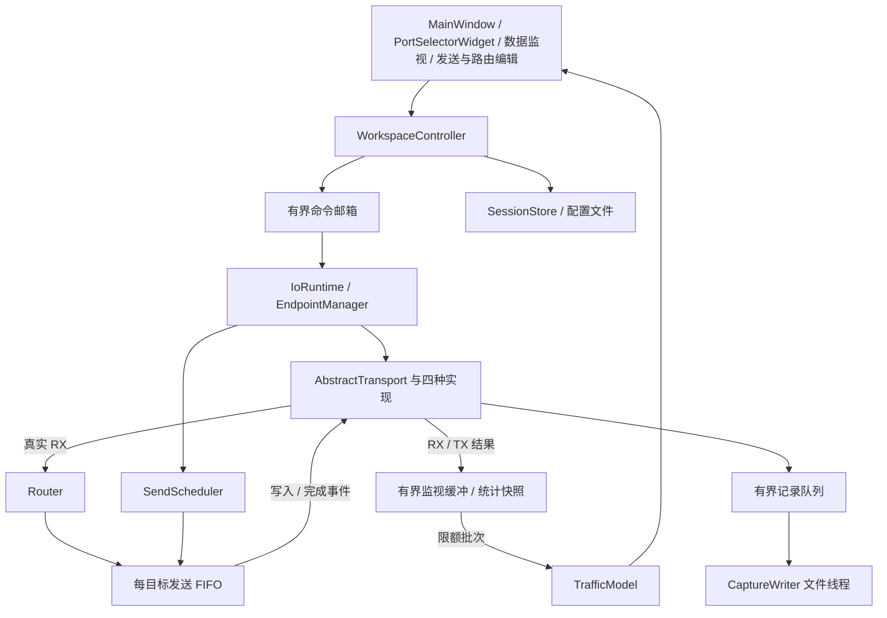

# easyDebug 架构设计

版本：0.1 设计基线，2026-10-01。本文规定未来实现的职责和行为；当前已落地的界面原型按 `src/ui/panels`、`src/ui/common` 组织，通信接口和运行时仍按下文设计逐步实现。

## 1. 架构目标与依赖方向

采用分层的模块化单体。核心原则是通信不访问 QWidget，原始字节桥接不经过文本转换，所有高频入口都有容量限制。运行时固定管理 A、B 两个端点；以 Qt 的事件驱动 I/O 为基础，先用一个通信线程维持清晰的顺序和所有权，再依据性能报告决定是否拆分。



箭头表示数据/命令流，不代表全部对象互相持有。传输层只依赖 domain 和 Qt I/O；路由/发送层依赖传输契约，不依赖具体控件。应用层组装对象，UI 依赖应用层公开接口。配置、记录是外围服务。

## 2. 模块和对象职责

| 模块/对象 | 责任 | 不承担的责任 |
| --- | --- | --- |
| domain | 配置、标识、数据事件、错误、发送结果、规则等值类型 | 控件与 I/O 生命周期 |
| PortSelectorWidget | 一个端点行：类型、参数、校验提示、状态与打开/关闭意图 | 创建 socket、写数据、保存文件 |
| PortConfigPageFactory | 按 PortType 创建 Serial/TcpClient/TcpServer/Udp 参数页 | 持有通信后端 |
| WorkspaceController | 工作区意图、配置快照、向 I/O 发命令、接收状态 | 字节转发与逐包显示格式化 |
| IoRuntime | 通信线程入口、处理命令批次、协调关闭 | GUI 交互 |
| EndpointManager | 端口实例表、generation、状态和 peer 目录 | 参数页显示 |
| TransportFactory | 按配置创建独立后端实例 | UI 注册 |
| AbstractTransport | 异步打开、关闭、接收、写入及 peer 事件契约 | 协议业务与路由决策 |
| SerialTransport | QSerialPort 参数应用、收发、错误 | 枚举串口列表 |
| TcpClientTransport | QTcpSocket 连接、超时、可取消连接 | 把连接请求当作连接成功 |
| TcpServerTransport | listener、已连接 peer、按 peer 收发 | 隐式向全部客户端广播 |
| UdpTransport | bind、receiveDatagram、按明确目标 writeDatagram | 将 UDP 伪装为可靠字节流 |
| Router | 源匹配、目标展开、规则状态、分包、拥塞策略 | 文本显示和设备协议解析 |
| SendQueue | 每目标 FIFO、短写 offset、额度、结算 | 无界缓存或自动重放失败请求 |
| PayloadEncoder / SendScheduler | 严格编码；单次、周期与顺序任务 | 在定时槽中阻塞等待或补发积欠 tick |
| TrafficBuffer / TrafficModel | 有界事件缓冲、批量显示、筛选与预览 | 影响 Router 或改写原始数据 |
| CaptureWriter | 异步保存原始数据和元数据、轮转、错误报告 | 占用 I/O 线程写磁盘 |
| SessionStore | 版本化配置、校验、原子保存、导入导出 | 持有运行时 peer/socket 指针 |
| PortDiscoveryService | 后台发现串口/网卡并发布列表快照 | 自动更改已打开端口的配置 |
| PageRegistry / PageHost | 注册、创建和切换功能页面 | 持有传输或协议业务状态 |
| MessageEditorPage | 编辑消息、命令列表和发送参数 | 编码实现、发送队列和端口写入 |
| ProtocolInspectorPage | 展示解析结果、字段和错误 | 修改原始字节或影响透明转发 |
| YmodemTransferPage | 选择文件、目标和传输控制 | 实现 YMODEM 状态机和文件 I/O |
| ProtocolRegistry / ProtocolSession | 注册协议、维护按端口/peer 隔离的解析会话 | QWidget、页面导航和配置落盘 |
| TransferManager | 管理文件任务、进度、取消和结果 | 直接操作页面控件 |
| PreferencesStore | 保存地址输入历史、主题、语言、窗口和快捷键偏好 | 保存端口运行时状态 |
| AboutDialog | 展示版本、许可证和构建信息 | 访问通信对象 |

对象由组合根显式注入，避免 Global::port、全局单例或主窗口承担业务中转。轻量 DTO 可用 QtCore 类型；地址在传输边界使用 QHostAddress 校验。首版不引入动态插件框架。

已实现的界面服务：`discovery/PortDiscoveryService` 在线程池枚举串口并发布 `SerialPortDescriptor` 值对象快照；`persistence/PreferencesStore` 通过 QSettings 保存用户级地址历史，过滤无效值、去重并限制为每类 20 条。`domain/networkaddress` 提供历史与输入共用的地址完整性规则。MainWindow 仅装配服务和控件信号，不执行扫描或存储：它持有两个 `PortSelectorWidget`，把发现服务和偏好存储同时接到两者，并在任一端点变更时汇总校验结果下发给桥接行；服务不依赖 QWidget。轻量偏好在编辑提交时保存，后续通信记录和工作区大文件仍使用独立 worker。

## 3. 类型、身份和时间

| 值类型 | 核心字段与约束 |
| --- | --- |
| EndpointConfig | `id: QUuid`、name、PortType、类型专属参数 variant、重连策略、缓存限制 |
| EndpointSession | EndpointId + 单调递增 generation；每次重新打开/替换类型产生新代次 |
| PeerSession | EndpointSession + PeerId；TCP Server 每次接受连接生成新 ID，不使用列表下标/裸 socket descriptor 作为身份 |
| IngressFrame | frameId、source session、可选 peer、source address、sequence、monotonicNs、wallClockUtc、StreamChunk/Datagram、payload |
| SendRequest | requestId、origin（Manual/Scheduled/Forward）、可选 frameId/routeId、目标 session、目标 peer/address、payload |
| SendResult | requestId、目标、admittedBytes、qtAcceptedBytes、localWrittenBytes、状态、错误码与消息 |
| RouteRule | id、enabled、source EndpointId、来源过滤、目标选择、分包配置、拥塞策略、revision |
| TrafficEvent | RX/TX/State/Error、session、peer、关联 request/frame/route、实际/原始长度、预览、截断标记 |
| Statistics | RX 字节/报文、TX 已接受/本地完成字节、队列积压、失败/拒绝、路由丢弃、显示遗漏、记录遗漏 |

`QByteArray` 使用隐式共享，发布后视为不可变；不在转发路径调用 toHex/toUtf8、不反复 append 大块 buffer。多路转发可共享同一 payload，但每目标仍保守计入额度。预览用限定长度的新 QByteArray，不能用保留整个大 payload 的视图伪装成小缓存。

串口与 TCP 是字节流，readyRead/read 片段不等于完整协议帧。内部 StreamChunk 只是读缓冲片段。UDP 一次接收对应一个 Datagram，包括长度为零的数据报。

顺序保证范围为同一源 session/peer 内的 sequence，以及同一目标的 FIFO。多个来源按 I/O 线程的入队顺序合流，不宣称跨端口存在物理全局时序。展示使用墙钟时间；超时、速率和调度使用 QElapsedTimer/单调时钟。

## 4. 传输接口契约

以下为逻辑签名，实际 `.h` 在 M1 落地，补齐类型、元类型注册和所有权声明：

```cpp
class AbstractTransport : public QObject {
    // 仅由 I/O 线程调用，返回值不表示远端已就绪。
    virtual void open(const EndpointConfig &config, quint64 generation) = 0;
    virtual void close(CloseMode mode) = 0;
    virtual AdmissionResult submit(const SendRequest &request) = 0;

    // 事件：stateChanged(StateSnapshot)、received(IngressFrame)、
    // peerChanged(PeerEvent)、sendProgress(SendResult)、errorOccurred(PortError)。
};
```

`submit()` 在 I/O 线程同步完成容量预约，返回 Admitted、NotReady、NoTarget、QueueFull、InvalidPayload 或 StaleSession；真正写入及完成是后续事件。GUI 从不跨线程直接调用该函数，只向有界邮箱投递命令，获得最终 admission 结果后更新 UI。

发送状态区分：Requested → Admitted → Writing → LocalCompleted；任一步可 Rejected/Cancelled/Failed。TCP 广播在目标展开时产生每 peer 子请求与结果，父请求汇总部分成功；没有客户端时返回 NoTarget。

流写入返回 `n > 0` 时只推进 n 字节，`n == 0` 时保留剩余数据并等待可写事件或有退避的单次重试，`n < 0` 时失败。一个请求未完成提交前不插入下一个请求的字节；bytesWritten 按 FIFO 分配给已接受的请求，避免重复计数。进度事件合并发布，不能每几个字节跨线程发通知。

`localWrittenBytes` 对 TCP/串口由 bytesWritten 累加，表示本地设备/系统写出进度，不代表远端应用接收；UDP 根据 writeDatagram 返回值记录本地提交结果。UDP 必须整报接受（返回值等于 payload 长度，零长报文返回 0 也算成功）；短返回作为整报失败，不补发尾部为另一个数据报。

断线时对未完成请求报告已知的本地完成量与失败状态，远端收到多少可能未知。不跨重连自动重发旧请求，防止设备重复执行命令。

## 5. 生命周期、线程与关闭

### 5.1 线程归属

GUI 线程拥有所有 QWidget、TrafficModel、WorkspaceController 和 UI 定时器。I/O 线程拥有 IoRuntime、EndpointManager、Router、SendScheduler、所有 QSerialPort/QTcpSocket/QUdpSocket/QTcpServer 及其定时器；对象在 I/O 线程创建和销毁。

文件 worker 负责记录和配置磁盘读写，返回有界结果；串口发现用后台单任务执行器，最多一个枚举任务在途，1 秒内重复刷新合并。枚举结果传值回 GUI；不从该线程操作通信实例。

线程边界仅传可复制的 DTO/不可变 payload，不传 QWidget、socket 指针或指向临时数据的 view。QObject parent 必须与子对象同线程；不要将带 GUI parent 的对象 moveToThread。关闭 worker 的资源释放完成后才退出事件循环。

### 5.2 状态

| 当前状态 | 触发 | 下一状态 |
| --- | --- | --- |
| Closed | 合法 open 请求 | Opening |
| Opening | 串口打开/TCP 连接成功 | Open |
| Opening | TCP Server listen 成功 | Listening |
| Opening | UDP bind 成功 | Bound |
| Opening | 连接失败、超时、资源错误 | Error |
| Opening/Open/Listening/Bound/Error/Reconnecting | 用户关闭或退出 | Closing → Closed |
| Open/Listening/Bound | 致命端口错误 | Error |
| Error | 已启用重连且故障可恢复 | Reconnecting → Opening |

单个 TCP Server 客户端断开只改变该 peer，listener 保持 Listening。Listening 并不等于有可写客户端；Bound 不等于已验证远端存在。统计展示分别标明端口和 peer 状态。

重连默认关闭；开启后用 1、2、4、8、16、30 秒上限退避并加小幅抖动，成功后复位。手动关闭取消重连与发送任务。串口重连优先核对保存的序列号/VID/PID，无法唯一定位则等待用户选择，避免枚举顺序改变后接错设备。

切换类型采用关闭旧实例→结算/取消队列→确认 Closed→新 generation 建立实例。旧连接的 callback、延迟命令、监视事件都携带 generation，不能操作新端口。每实例一次性安装信号，使用保存的 QMetaObject::Connection 或对象销毁自动断开。

### 5.3 停止行为

1. 停止新增周期任务和路由准入，命令邮箱拒绝新发送。
2. 显式“断开”立即取消尚未提交给 Qt 的数据；已提交部分无法撤回，结果标明可能已部分写出。
3. 正常退出可异步等待最多 2 秒排空已接受数据；超时后取消并关闭。GUI 继续处理事件，不调用 waitForBytesWritten/waitForConnected/sleep。
4. 记录 worker 排空或超时停止并生成记录状态；关闭所有后端与 timer，确认销毁后 quit I/O 线程。
5. 线程 finished 后完成窗口退出。禁止 QThread::terminate；对象销毁后的事件由会话代次和 QObject 连接机制共同屏蔽。

## 6. 路由模型与语义

### 6.1 一次接收、一次路由决策

真实 received → 记录 RX 和统计 → Router 匹配启用规则 → 展开目标 → 校验 session/容量 → 目标 SendQueue → 记录 TX 结果。显示和记录旁路仅 tryPush，不等待消费者。

只有真实 RX 能触发路由。TX 记录、UI 显示事件、手动发送和转发完成事件都不能再次成为 ingress。内部 frameId 用于关联与去重，源→目标的重复匹配在同一次 ingress 中最多投递一次；创建时拒绝等价/重叠而不可区分的重复规则。

拒绝 source EndpointId == target EndpointId 的规则。双向桥是 A RX→B TX 与 B RX→A TX 两条规则，可作为一个分组启停，不会因内部 TX 事件产生循环。真实外部设备若回显字节，将形成新的 RX；透明字节协议无法可靠识别物理回环。界面提示潜在拓扑环，提供速率/拥塞熔断与一键停转发，不用“相同 payload 丢弃”误伤合法重复数据，也不宣称内部 hop 标记能阻止外部回环。

### 6.2 目标选择

| 目标类型 | 可选择目标 | 行为 |
| --- | --- | --- |
| 串口/TCP Client | 指定 EndpointSession | 打开/连接后才可写 |
| TCP Server | 固定 peer、当前全部 peer | 全部模式在每次 ingress 准入时快照 peer 列表，新加入客户端不接收旧队列 |
| UDP | 固定 IP:port、明确选中的最近来源地址快照 | 不因另一发送方来包而悄悄改变目的地址 |

TCP Server→串口默认要求一个选定来源 peer，避免并发客户端指令混流。开启“全部来源汇聚”后，仅保证每源内部顺序及读片段内连续性，不提供事务/请求响应配对。串口返回到 TCP 的目标须单独指定为固定 peer 或全部 peer；不假装能根据串口字节自动推断原请求者。

UDP 来源列表使用 address:port，记录 lastSeen，有条目上限；选定目的地址后保存为明确地址。未来“请求者自动回包”需要协议关联层，首版不实现。

### 6.3 数据边界转换

| 输入 → 输出 | 首版规则 |
| --- | --- |
| 流 → 流 | 原始字节透明转发；保留顺序，不保留原 read 分块 |
| Datagram → Datagram | 一个输入报文对应一个输出报文，不合并、不擅自拆分 |
| Datagram → 流 | 按接收顺序写 payload；UDP 边界在字节流中消失，界面明确说明 |
| 流 → Datagram | 必须选择分包器：固定上限＋尾部超时、分隔符（保留分隔符）或显式“按接收片段” |

流→UDP 推荐起始配置是最多 1200 字节/报文、尾部等待 10 ms；这些是应用分包规则，不代表还原设备协议帧。分隔符模式必须配置最大报文长度，超限则暂停该规则并报告，不能无界累积。按接收片段模式受操作系统分块影响，输出边界不稳定，必须由用户主动选择。

分包器状态按 `(routeId, source generation, source peer)` 隔离，不能把两个 TCP 客户端的尾部拼在一起。每个生成的 UDP 包只属于一个来源；规则停用/源断开时默认丢弃未完成尾部并记录字节数，正常退出可按显式 drain 策略刷新。

IPv4 UDP payload 最大 65507 字节；配置的最大报文更小时以配置为限。超长报文拒绝并计数，绝不静默截断。首版不为透明转发增加私有重组头。

### 6.4 路由更新

规则编辑先验证配置和目标，提交完整不可变列表及 revision，在 I/O 线程一次替换。被删除/停用规则不再接收新 ingress；未交给 Qt 的关联请求取消，已经交给 Qt 的数据无法撤回。分包尾部同时结算，不留孤儿 timer。未变更规则的状态可保留，变更规则的新 revision 从空分包状态开始。

端口断开时规则进入 Waiting/Degraded 并提示原因，不积压离线数据。端口恢复后，仍处于用户启用状态的规则只转发新的 RX；固定 peer 丢失则等待重新选择，不能按列表位置自动替代。

## 7. 缓冲、背压与公平性

### 7.1 起始预算

以下均是可配置初值，需经 M6 校准。MiB 按 1024² 字节计算。

工作区固定为 2 个端点、1 条 A/B 桥接草稿、512 条自定义命令；每个 TCP Server 最多 64 个客户端。UDP 最近来源列表最多 256 项，按最近活动淘汰。连接与配置数量同样需要上限，避免仅约束 payload 而遗漏对象/读缓冲开销。

| 位置 | 初始上限 | 满时行为 |
| --- | --- | --- |
| GUI→I/O 命令邮箱 | 1 MiB payload 或 256 条 | 同步拒绝新发送；控制指令使用独立保留槽 |
| 每目标应用发送队列 | 4 MiB 或 4096 项 | 按规则策略背压/失败，手动发送报告 QueueFull |
| 每目标 Qt 写入窗口 | 256 KiB | 暂停 submit 到设备，等待 bytesWritten |
| 全部目标应用队列＋Qt 写入额度 | 64 MiB | 全局准入限流，不能靠增加客户端突破 |
| 每流 Qt 读缓冲 | 256 KiB | TCP 停读形成背压；串口取决于驱动/硬件流控 |
| 待路由 ingress | 全局 8 MiB 或 8192 项 | 对可背压源停读，否则按不可背压策略处理 |
| UDP 分包尾部 | 每来源最多一个配置长度；全局 2 MiB | 拒绝新尾部并暂停相关规则 |
| I/O→GUI 监视暂存 | 8 MiB 或 8192 条 | 丢最旧预览、累计缺口计数 |
| GUI 在途批次 | 最多 1 个，256 KiB 或 512 条 | GUI 消费确认后发送下一批 |
| GUI 历史模型 | 16 MiB 或 20000 条，先到者为准 | 淘汰最旧记录，预览每条最多 4 KiB |
| 文件记录队列 | 32 MiB 或 16384 条 | 停止记录、标注不完整；转发继续 |

所有容量都同时限制条目数与字节数，避免大量零长/小包耗尽元数据内存。UDP 零长数据报仍占一个条目。metadata、in-flight、旧 generation 残留、持有 payload 的结果对象均计入预算；完成记录只保存元数据，不永久持有完整请求。

每目标应用队列保守计算仍被持有的完整 QByteArray，而非仅减去 offset；Qt 写缓存另计额度，防止部分写期间的重复占用被漏算。跨线程传递前完成容量预约，消费者释放后归还额度。只给 QObject 连接加 QueuedConnection 并不能提供背压。

### 7.2 发送拥塞

高水位为目标上限的 75%，低水位为 50%。默认“可靠流”规则在高水位暂停相关 TCP 源的读泵，低水位后恢复。有限 readBufferSize 使 Qt 读缓冲最终向 TCP 发送端传递压力。已读数据进入有界待路由缓冲，不再继续无界 readAll。

对于暂停前已接收的片段，保存剩余目标集合；目标准入成功后移出集合，恢复时不能重复发送给已经成功的目标。默认按规则保证 FIFO；同一广播规则选择“全部目标背压”时，慢 peer 会使该规则等待，UI 标出阻塞目标。

串口仅在设备正确支持 RTS/CTS 或 XON/XOFF 时可能传递端到端背压；仅仅停止 read 不保证驱动不丢数据。UDP 无应用层背压。不可背压来源达到容量时，首版默认暂停受影响规则并报告明确的数据缺口，后续 RX 仅显示/统计，不继续悄悄转发残缺会话。用户可显式选择“尽力转发”，此时按整个片段/报文丢弃并计数。

TCP Server 广播提供第二种明确策略“隔离慢客户端”：慢 peer 达硬上限时断开该 peer，结算队列并报告，其余 peer 继续。不能静默丢弃某段 TCP 字节后仍声称该 peer 的透明流完整。路由配置必须能看到所选策略。

### 7.3 调度公平

单次读泵最多处理 256 KiB 或 64 个数据报，并限制时间片约 2 ms，之后投递一次后续工作让出事件循环；仍有数据时主动续调度，不仅依赖下一次 readyRead。同一源 chunk 上限 64 KiB。

目标 FIFO 中每请求连续提交，多个生产者按轮转准入，定时发送不压过控制指令。每轮处理固定字节/项预算，禁止 while 忙等到全部写完。控制通道保留关闭/停发/停路由容量，数据拥塞时仍能停止。

## 8. 监视显示与文件记录

RX 在接收后计数，TX 在不同状态分别更新。广播物理 TX 按各 peer 相加，同时保留逻辑请求计数；关闭显示、筛选和清空都不改变收发统计。清零统计只设置新的统计基点，不修改正在完成的发送账本。

TrafficBuffer 在 I/O 线程接收有界预览，GUI 以 33–50 ms 节拍拉取；最多一个批次在途，GUI 确认后开放下一批。不逐包投递 GUI 信号，不在 GUI 线程构建无限长字符串。

高频状态、统计和重复错误合并成快照，最多每 100 ms 发布一次且只保留一个在途通知；离散错误进入有界事件环并记录合并/遗漏数量。命令响应按 requestId 保留到消费确认，但容量受在途命令数限制，不能另建无界“结果队列”。

TrafficModel 使用 QAbstractTableModel＋QTableView 的可见区域绘制，时间/端口/peer/方向/状态/长度/数据为固定列。格式化在 GUI 按需执行，禁用大表自动遍历调整列宽。文本模式需按流 session/peer 增量解码 UTF-8；UDP 每报独立解码。原始字节仍是事实依据，裁剪或缺口会重置增量解码器并标出边界，不能把碎片显示成完整消息。

暂停显示仅冻结视图，不无限积压新数据；恢复时展示最近窗口和遗漏计数。单条大数据预览截断，显示实际字节数、已保留长度；需要完整历史时须事先开启原始记录。

CaptureWriter 的记录格式首版采用 UTF-8 JSONL：schemaVersion、时间、session、peer/address、direction、request/frame/route 标识、事件状态、payloadBase64、原始长度。原始 RX/发送内容与结果事件可关联。一次发送内容只记录一次，进度记录不重复保存 payload。编码和磁盘写入在文件线程完成，Base64 扩张与当前批次也受内存预算约束。

默认 100 MiB 轮转、最多 10 个文件；只管理当前记录会话自己创建的文件。磁盘满、无权限、队列满时停止本次记录，显示“记录不完整”和缺口统计，不能声称得到完整抓包；停止转发不是默认响应。普通诊断日志与原始记录分开，避免日志风暴挤占数据路径。

## 9. 自定义发送

编码顺序：校验内容模式→生成原始字节→追加选定尾部→预览及字节数→容量预约→发送。首版单次自定义内容上限 64 KiB，UDP 还受目的最大报文限制。大文件流发送留作扩展。

| 模式 | 语义 |
| --- | --- |
| 文本 | UTF-8 默认；可选 Latin-1（不可编码字符报错），不隐式依赖系统本地编码 |
| HEX | 支持 `01 AF 00`、`01AF00` 或 `0x01 0xAF 0x00`；严格偶数十六进制数位，前缀 token 必须两位；拒绝非法字符 |
| 转义字节 | 普通文字按所选编码，`\r`、`\n`、`\t`、`\0`、`\\` 与严格两位 `\xNN` 直接生成字节；未知/不完整转义报错 |
| 尾部追加 | 无、CR、LF、CRLF、严格 HEX 尾部；显示最终 payload 防止重复换行 |

不直接依赖 QByteArray::fromHex 的宽松过滤作为输入校验。`\xFF` 必须生成单字节 FF，不能先变成 Unicode 再重新编码。

SendProfile 保存名称、目标策略、模式、内容、尾部、intervalMs、repeatCount、是否启用；repeatCount=0 表示持续，UI 必须显示。支持单次、固定周期、多行按序循环。周期初始最小值 10 ms，属于尽力调度，不能承诺 Windows 上硬实时精度。

一个任务使用固定配置快照；编辑不改变正在发送的当前请求，重新开始后应用。每目标最多一个该任务的未完成请求，拥塞时跳过该 tick 并统计 missedTicks，不累积重放。顺序任务在前一项 LocalCompleted 后等待间隔，失败则停止。断开/换代/目标 peer 消失时停止任务，不把旧定时命令发给后来连接的设备。

## 10. 配置与持久化

使用 QStandardPaths::AppConfigLocation 定位工作区 JSON；窗口几何/主题等轻量偏好使用 QSettings。文件系统读写在 worker，QSaveFile 原子提交，失败保留旧文件并报告。启动时只从通过完整校验的 DTO 快照创建工作区。

配置示意（字段命名在 M1 定稿，以下不是当前可导入格式）：

```json
{
  "schemaVersion": 1,
  "endpoints": [
    {"id": "6614ddce-5efb-4df5-8f21-000000000001", "name": "串口 A", "type": "serial", "serial": {"portName": "COM3", "baudRate": 115200, "dataBits": 8, "parity": "none", "stopBits": "one", "flowControl": "none"}},
    {"id": "6614ddce-5efb-4df5-8f21-000000000002", "name": "TCP B", "type": "tcpServer", "tcpServer": {"bindAddress": "127.0.0.1", "port": 9000, "maxClients": 64}}
  ],
  "routes": [
    {"id": "6614ddce-5efb-4df5-8f21-000000000003", "source": "6614ddce-5efb-4df5-8f21-000000000001", "target": "6614ddce-5efb-4df5-8f21-000000000002", "targetMode": "allPeers", "enabled": false, "overflowPolicy": "disconnectSlowPeer"}
  ],
  "sendProfiles": [],
  "startup": {"openEndpoints": false, "enableRoutes": false, "startSending": false}
}
```

peerId、generation、socket 指针与待发送缓存永不持久化。固定 TCP peer 规则保存“待选择目标”的意图，重启后必须重新选择当前连接，不能按远端 IP:port 当成同一会话。

读取时校验 schemaVersion、大小（初值 4 MiB）、记录数量、ID 唯一性、引用存在性、端口范围和类型参数。远端端口为 1–65535，本地绑定可用 0 请求临时端口并显示实际值。未知新版本拒绝加载并保留原文件；损坏文件给出原因与默认空工作区，不自动覆盖。工作区导入默认新建会话，显式应用才替换运行配置。

## 11. 目录与构建演进

```text
easyDebug/
├── easyDebug.pro                # qmake 入口，实施阶段组织模块 .pri
├── main.cpp                     # 组合根入口
├── mainwindow.{h,cpp,ui}         # 组合根窗口
├── src/
│   ├── domain/                  # 值类型、配置、结果
│   ├── app/                     # Controller、IoRuntime、EndpointManager
│   ├── transport/               # 接口、工厂、serial/tcpclient/tcpserver/udp
│   ├── routing/                 # Router、规则、UDP 分包
│   ├── sending/                 # PayloadEncoder、SendQueue、Scheduler
│   ├── monitoring/              # 缓冲、统计、模型
│   ├── persistence/             # SessionStore、CaptureWriter
│   ├── discovery/               # 串口与网卡发现
│   └── ui/
│       ├── shell/               # PageHost、PageRegistry；当前 MainWindow 仍在项目根目录
│       ├── panels/              # portselector、traffic、sending、routing
│       ├── pages/               # messageeditor、protocolinspector、transfer
│       ├── settings/            # SettingsDialog 和设置分组页面
│       ├── dialogs/             # AboutDialog 等低频对话框
│       └── common/              # PayloadPreview 等复用组件
├── version/                     # 版本清单、生成头文件和 qmake 版本入口
├── resources/                   # 图标、翻译、样式
├── scripts/                     # 构建、部署和版本脚本
├── tests/                       # FakeTransport、Qt Test、集成与性能驱动
└── docs/                        # 设计及验收记录
```

实施阶段使用 `QT += core gui widgets network serialport`、`CONFIG += c++17`；MSVC 增加 `/utf-8`。Qt Test 单独工程链接核心模块，避免让 UI 成为核心测试前提。首版只维护 qmake，一旦需要迁移 CMake，单独设计与提交，避免两个构建源同时漂移。

## 12. 决策记录

| 决策 | 理由 | 代价/后续触发条件 |
| --- | --- | --- |
| Widgets 与通信分离 | 复用旧控件体验，支持后台 I/O、自动测试和多实例 | 需要重写旧 AbstractPort，不直接继承 |
| 单 I/O 线程 | 保持路由顺序、少跨线程复制，适合首版 16 端口规模 | 若核心达到性能瓶颈，再按实例分片，不先造线程池通信框架 |
| UDP 统一一种端口 | UDP 是绑定＋目的地址，旧 Client/Server 两类重复度高 | 通过模板/默认值兼容两类使用习惯 |
| 有界旁路与显式缺口 | 让慢 UI/磁盘不拖垮转发 | 高负载显示是预览，完整数据需记录且记录也有容量限制 |
| 不在透明转发中识别业务协议 | 用户指定串口/TCP/UDP 的通用调试目标 | 响应关联、设备协议、Ymodem 作为上层扩展 |
| 原始字节不承诺零拷贝 | Qt/操作系统写入仍可能复制 | 用测量验证分配、吞吐和延迟，避免虚假性能承诺 |
