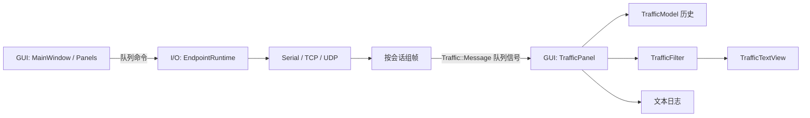

# QQCom 架构

本文只描述当前实现。项目采用模块化单体，组合入口在 `main.cpp` / `mainwindow.cpp`，无插件框架、通用事件总线或每端点独立线程。

## 模块职责

| 位置 | 职责 | 边界 |
| --- | --- | --- |
| `src/domain` | 端口草稿、接收组帧配置、消息、指令与分组值对象 | 不依赖控件或通信实例 |
| `src/transport` | Serial / TCP Client / TCP Server / UDP 的打开、关闭、读写和 peer 状态 | QObject + Qt 异步 I/O，不持有 QWidget |
| `src/app` | EndpointRuntime、ReceiveFramer、CommandManager、CommandFormats、PayloadChecksum、FileTransferService | 运行时协调、纯字节组帧、分组管理、格式适配、文件载荷校验与传输协议 |
| `src/discovery` | 在线程池枚举串口，合并重叠请求，发布变化快照 | 不操作界面；网卡枚举目前仍由端口控件完成 |
| `src/persistence` | QSettings 偏好、地址历史及旧产品配置迁移 | 显示偏好延迟落盘，地址历史显式同步 |
| `src/automation` | 原生 CLI、同用户命名管道、能力 Schema 和参数校验 | CLI 自动发现实例；不持有控件或通信实例 |
| `src/ui/common` | 编码、格式化、图标、尺寸与公共对话框 | 不重复实现业务文件格式 |
| `src/ui/panels` | 端口、监视、发送、快捷指令、A/B 桥接 | 面板各自管理交互，主窗口接线 |
| `resources` | QSS、图标和 Qt 资源 | 图标随资源一起提交 |
| `tests` | core、ui、perf、stress | 与产品共享实际模块源码 |

`QQCom.pro` 聚合 `src/ui/ui.pri` 和 `src/services.pri`；后者再引入 domain/transport/app/discovery/persistence 的 `.pri`。核心测试只引入服务层。根目录主窗口作为组合入口保留，无需为目录对称而搬动或创建空模块。

## 线程与数据流

一个专用 I/O 线程承载两个端点的运行时、socket/串口和组帧定时器；GUI 线程拥有控件、历史模型和日志文件。串口发现通过 QtConcurrent 在线程池执行。跨线程传递值类型，不从 I/O 线程访问控件。

每次开启端点使用新的 generation，主窗口据此忽略旧会话回调。TCP 服务器的每个 peer 有独立 UUID、来源、ReceiveFramer 和按需创建的单次精确定时器。串口/TCP 客户端各用自己的组帧会话；UDP 未启用组帧时保留数据报边界，启用时按来源 IP＋端口隔离组帧会话，允许跨数据报拼接。UDP 会话在缓冲排空或空闲输出后回收定时器，避免历史来源永久占用组帧资源。

收到非空数据后重置该会话的空闲计时，缓冲清空后停止计时。peer 离线或端点关闭时输出对应残留数据并释放会话。主窗口退出先在 I/O 线程 shutdown，再处理排队的尾帧；监视面板销毁前写完尚未记录的批次。

## 消息与监视

`Traffic::Message` 保存来源端点/peer、时间、方向、原始字节、真实长度、截断及组帧标记。Info/Warning/Error/State 不计入 RX/TX 字节，示例数据不发送给真实设备。显示编码与派生文本不写回消息。

`TrafficPanel` 以 16 ms 定时攒批，每轮最多处理 512 条 / 64 KiB 原始载荷（单条超过预算仍完整处理），积压交还事件循环后继续，不主动丢弃。`TrafficModel` 管历史预算，`TrafficFilter::Matcher` 负责结构条件和文本短路匹配，`TrafficTextView` 负责批量文本插入、滚动和视图容量。显示设置改变时重绘历史；过滤输入的当前条件与历史已应用条件分别保存，语义见 [界面约定](UI_DESIGN.md)。

历史重建仍在 GUI 线程操作文档，按 256 条子批执行，每轮约 6 ms 后让出事件循环（单个子批的布局不可抢占）。同一时刻仅一个任务持有条件与外观快照；重建期间修改过滤条件或显示设置，立即停止旧定时回调并按最新条件从头重建，相同请求不重启。已完成快照也参与去重（过滤条件、格式、显示设置、主题）；增量记录仍使用相同快照时直接复用结果。按其他条件接收过数据则标记历史偏离，包含整批被过滤的情况，防止条件改回后错误跳过重建；载入示例整体替换模型时使旧快照失效。历史和期间新增记录统一使用本轮快照，接收继续入模、写日志；没有等待旧任务完成的请求队列，也不需要跨线程取消或文档访问。按钮和底部状态栏显示重建中。空闲时编辑关键词仍只影响后续数据，点击「应用过滤」才回溯历史。清空和载入示例取消旧任务，防止旧批次写回新会话。重建前预留行号位数，避免百万行历史在位数增长时整屏重新布局。

当前容量是安全阀，不是整个程序内存上限：

- 单条历史载荷预览最多 4 KiB，同时保留原始长度与截断标记。
- 模型最多 512 MiB 预览载荷 / 2,000 万条记录，超限释放最旧记录，单批本身超限也受约束。
- 文本视图另有 400 万块 / 5.12 亿字符上限。模型和视图释放都必须提示，不能静默丢弃。
- 消息元数据、QString、文本布局和跨线程待处理事件另占内存。历史重建已分批，但清空旧文档和单批布局仍是同步 Qt 操作；日志仍在 GUI 写盘。

## 指令与持久化

`CommandManager` 管分组、原子跨组移动、撤销状态与配置读写，按单工作区使用；当前分组及显示偏好由 `CommandPanel` 持有。`CommandFormats` 是 QQCom JSON / JCom / BLE 文件格式的唯一适配入口；导入生成新身份，导出由 QSaveFile 原子提交。配置中的字段与枚举保持兼容，产品改名不改变文件格式。

`CommandTableWidget` 在每次行内编辑时只同步对应行到当前数据，再静默更新管理器。数据快照使用 Qt 隐式共享，复制、删除和拖动均消费同一份最新数据；普通编辑不广播反向重建。分组元数据变化不重建指令行，保留编辑器及选中范围。指令列表实际改变或切组时先通知面板停止批量发送；延迟拖动和右键菜单动作携带结构版本，旧动作不能操作新分组。重建仍保留控件延迟析构及批量几何同步保护。

`CommandSendScheduler` 独立管理批量时序，整批只使用一个单次定时器。截止时间以单调时钟和 64 位毫秒数累计，停止会撤销当前定时器并释放指令快照；信号回调中停止或重启通过代数校验隔离。面板只连接实际发送与进度，不查找表格内部按钮。配置仍即时更新，序列化缓存按分组失效，编辑一个分组只重新编码该组的指令；重复 UUID 的旧配置跳过共享缓存，避免内容被覆盖。

`CommandAutomation` 按 UUID 定位分组与指令，完整校验后通过 `CommandManager` 修改，更新只覆盖指定字段；界面通过原有 `setsChanged` 信号同步。CLI 支持分组与指令增删改、组内排序和完整内容分页读取。主窗口在成功修改后保存并同步偏好，分别报告内存应用与写盘结果；快捷指令发送尚未结束或界面正文编辑器未提交时拒绝外部修改。

`PayloadChecksum` 是文件载荷 CRC16-XMODEM 与 CRC32-IEEE 的唯一实现。协议层和发送区预览都调用它，包内校验和整文件累计使用同一套结果。

`PreferencesStore` 默认采用 QStandardPaths 的应用配置目录；显式传入文件路径时不自动迁移。QQCom 默认配置不存在时才复制旧配置，目标存在时优先保留新配置，迁移失败通过 `saveFailed` 上报。测试使用临时路径和独立应用身份。

## 当前边界

AI 接入由 `src/ui/automation/windowautomation.cpp` 在主窗口组合：端口开关复用现有动作路径，发送复用运行时和 PayloadCodec，查询读取实际面板与结构化历史。原生 CLI 在创建 QApplication 前使用 QCoreApplication 执行，能力描述不依赖界面插件。窗口自动提供同用户命名管道，并在应用数据目录写入带 UUID 的实例描述；CLI 探测在线实例，必要时启动窗口，多实例要求显式选择。每条连接处理一个有大小/超时限制的 JSON 请求；正常关闭移除描述，残留文件不计作在线实例。能力描述、参数校验和操作入口由 CLI 共用，控制通道只使用本机命名管道。发布时附带 CLI 启动脚本和 AI 操作说明，不修改 AI 客户端配置。接入流程、能力边界和发现约定见 [AI 接入](CLI.md)。

跨线程消息队列没有容量约束；TX 状态表示本地 write 接受结果，不能当作对端确认。TCP 服务器广播按接受最少的那个客户端记账，少写的字节记为丢弃。读失败和建立桥接时清掉的未读输入同样记成带字节数的错误行，状态栏累计显示。A/B 桥接在运行时把一端收到的原始字节原样写到另一端，保持到用户再点停止；端口断开、异常或改参数都不关闭。建立桥接时丢掉还没读走的输入；打开端点不在订阅接收之后再清空，避免吃掉第一包或打断串口等待。数据区可以单独隐藏转发行，隐藏不停止转发。统一发送队列和后台日志轮转均未实现。文件日志在勾选记录、下次启动仍在记录、清空，以及更改日志位置时新开一份带时间戳的文件。
